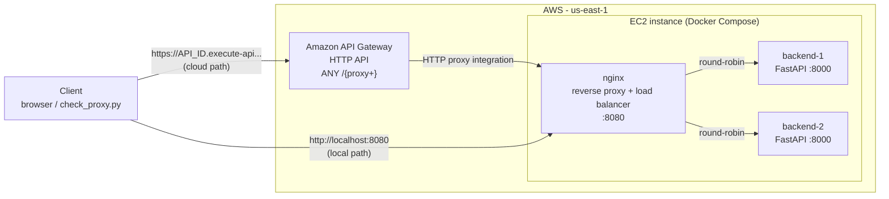
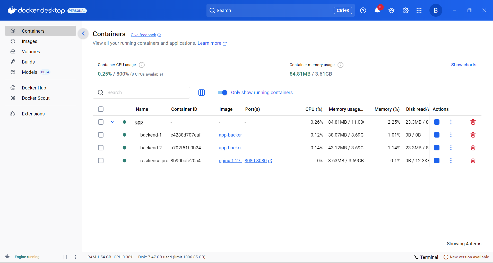
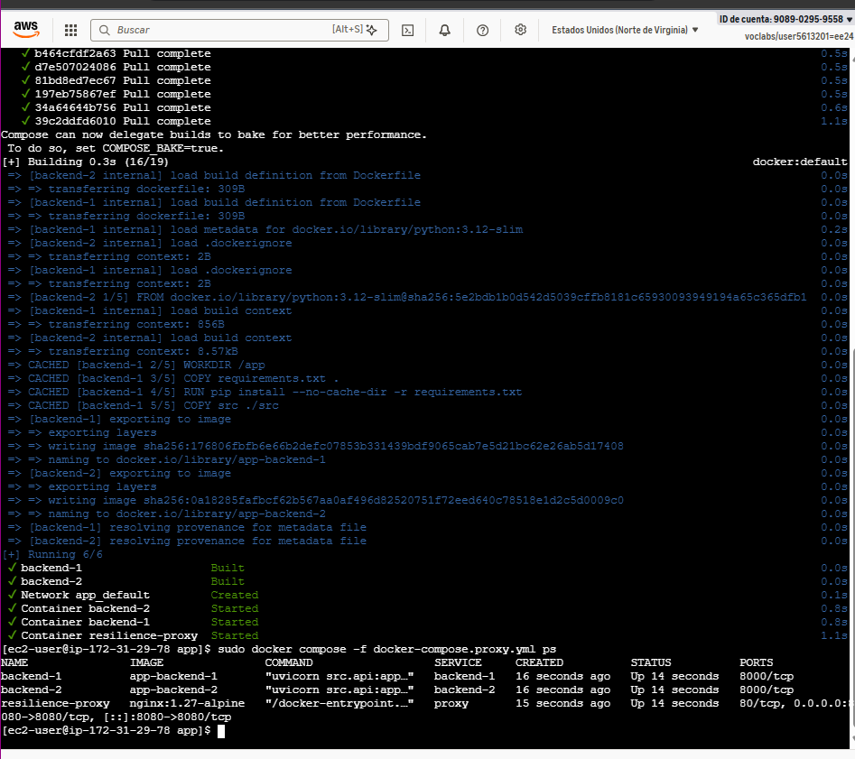
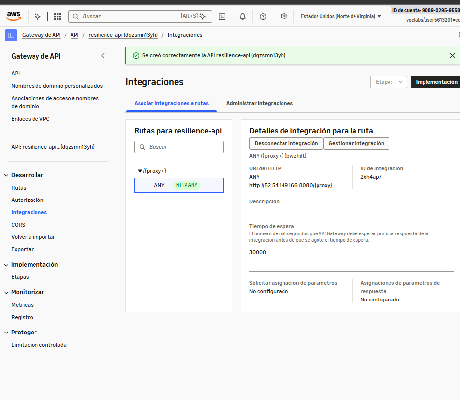
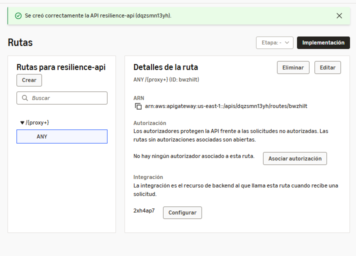

# API Gateway, Load Balancer and Reverse Proxy

## 1. Concepts

| Component | What it does | Where it lives in this exercise |
|---|---|---|
| **Reverse proxy** | Sits in front of the servers. Clients talk to the proxy, never to the backends directly, so the backends stay hidden. | **nginx** (`resilience-proxy`, port 8080) |
| **Load balancer** | Spreads requests across several identical servers and stops sending traffic to one that is down. | The nginx `upstream` block: `backend-1` and `backend-2`, round-robin, with `proxy_next_upstream` as failover |
| **API Gateway** | The public front door of an API. It publishes routes, and can add authentication, throttling and monitoring. | **Amazon API Gateway (HTTP API)**, which forwards every request to the nginx proxy |

In practice nginx plays two roles at once (reverse proxy + load balancer), and API Gateway is the managed
entry point placed in front of it.

## 2. Architecture diagram



The same stack runs locally with Docker Compose (local path) and on EC2 behind API Gateway (cloud path).

## 3. Source code and configuration

| File | Role |
|---|---|
| [`infra/proxy/nginx.conf`](../infra/proxy/nginx.conf) | Reverse proxy and load balancer. Upstream pool with two backends, `proxy_next_upstream` for failover, `X-Upstream-Addr` response header. |
| [`app/docker-compose.proxy.yml`](../app/docker-compose.proxy.yml) | Starts `backend-1`, `backend-2` and the nginx `proxy`. The original `docker-compose.yml` is untouched. |
| [`scripts/check_proxy.py`](../scripts/check_proxy.py) | Sends N requests and prints which backend answered each one. |

The backends are the same image, differing only in `INSTANCE_ID` (`backend-1`, `backend-2`). The response field
`instancia` reveals which one served the request.

## 4. Procedure

### 4.1 Local (reverse proxy + load balancer)

```bash
cd app
docker compose -f docker-compose.proxy.yml up --build -d
python ../scripts/check_proxy.py http://localhost:8080 6
```

Expected: 3 requests answered by `backend-1` and 3 by `backend-2`.

**Failover test.** Stop one backend and repeat:

```bash
docker stop backend-1
python ../scripts/check_proxy.py http://localhost:8080 6
docker start backend-1
```

Expected: all requests still succeed and are answered by `backend-2`.

Clean up when finished:

```bash
docker compose -f docker-compose.proxy.yml down
```

### 4.2 AWS (API Gateway in front of the proxy)

Reuses the EC2 instance `lift-and-shift-backend` and the Security Group `lift-shift-sg` from the
[Lift-and-Shift exercise](lift-and-shift.md).

1. **Open port 8080.** EC2 > Security Groups > `lift-shift-sg` > Edit inbound rules > add Custom TCP `8080`
   from `0.0.0.0/0`.
2. **Start the instance** (it was stopped) and copy its **new** public IPv4 address.
3. **Deploy the proxy stack.** Connect with EC2 Instance Connect and run:

   ```bash
   cd ~/cloud-resilience-lab
   git fetch origin
   git checkout feat/api-gateway-lb-proxy
   git pull --ff-only origin feat/api-gateway-lb-proxy
   cd app
   sudo docker compose down
   sudo docker compose -f docker-compose.proxy.yml up --build -d
   sudo docker compose -f docker-compose.proxy.yml ps
   ```

4. **Create the API.** API Gateway > Create API > **HTTP API** > Build. Integration: **HTTP**, method `ANY`,
   URL endpoint `http://<EC2_PUBLIC_IP>:8080/{proxy}`. API name `resilience-api`.
5. **Route.** Resource path `/{proxy+}`, method `ANY`. Keep the default stage `$default` with auto-deploy.
6. **Test** through the gateway invoke URL:

   ```bash
   python scripts/check_proxy.py https://<API_ID>.execute-api.us-east-1.amazonaws.com 6
   ```

7. **Stop the EC2 instance** when finished to save lab credit.

> The integration URL contains the public IP, which changes every time the instance is stopped and started. After a
> restart, edit the integration with the new IP.

## 5. Test results (evidence)

Evidence is stored in `docs/evidence/api-gateway-lb-proxy/`.

- [x] [`01-local-balancing.txt`](evidence/api-gateway-lb-proxy/01-local-balancing.txt): `check_proxy.py` against `http://localhost:8080`. Requests alternate between both backends (3 each).
- [x] [`02-local-failover.txt`](evidence/api-gateway-lb-proxy/02-local-failover.txt): same script with `backend-1` stopped. All 6 requests succeed, answered by `backend-2`.
- [x] `03-docker-containers.png`: Docker Desktop with `backend-1`, `backend-2` and `resilience-proxy` running



- [x] `04-ec2-containers.png`: `docker compose ps` on the EC2 instance



- [x] `05-api-gateway-route.png`: API Gateway integration. Route `ANY /{proxy+}` forwards to `http://<EC2_PUBLIC_IP>:8080/{proxy}`.



- [x] `05b-api-gateway-routes.png`: API Gateway route `ANY /{proxy+}`



- [x] [`06-apigw-check.txt`](evidence/api-gateway-lb-proxy/06-apigw-check.txt): `check_proxy.py` against the API Gateway invoke URL. All 6 requests succeed and are split 3/3 between `backend-1` and `backend-2`, proving the full path client -> API Gateway -> nginx -> backends.

### Summary

| Path | Requests | Result |
|---|---|---|
| Local, direct to nginx (`localhost:8080`) | 6 | 3 / 3, all OK |
| Local, `backend-1` stopped | 6 | 0 / 6 (all by `backend-2`), all OK |
| AWS, direct to nginx (`EC2_IP:8080`) | 6 | 3 / 3, all OK |
| AWS, through API Gateway | 6 | 3 / 3, all OK |

## 6. Trade-offs and limits

- **Advantage:** the clients see a single address, the backends can be added or removed without changing clients, and
  a failed backend is skipped automatically.
- **Limit:** nginx and both backends run on one EC2 instance, so the instance itself remains a single point of failure.
  A production design would use an Application Load Balancer across several instances and Availability Zones.
- **Limit:** API Gateway needs a public integration endpoint here (the EC2 public IP). A private integration
  through a VPC link is the production alternative.
- `proxy_next_upstream` retries only on connection errors, timeouts and 502/503. Application-level failures of a
  healthy backend are handled by the Circuit Breaker and Timeout patterns documented separately.
