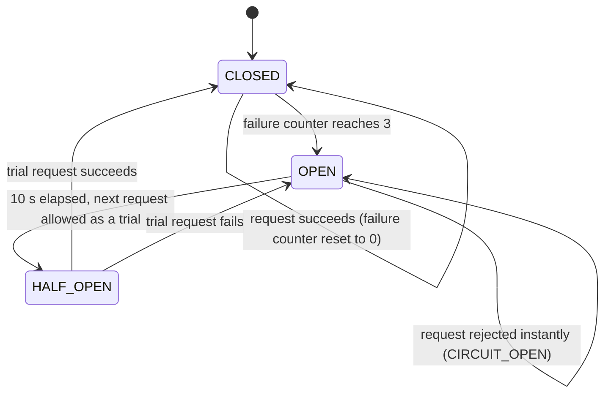
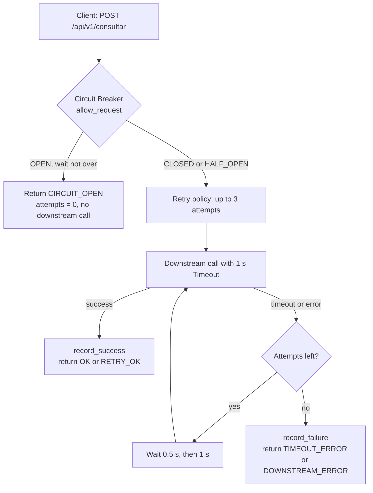
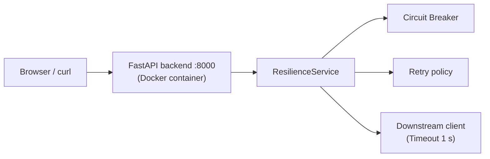
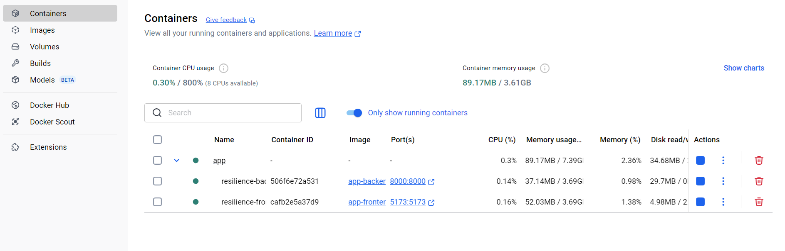
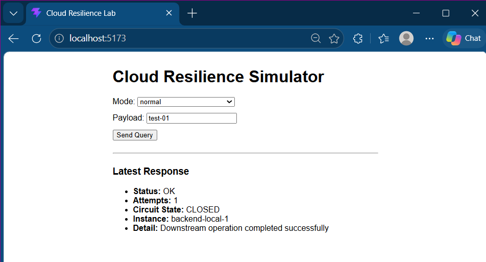
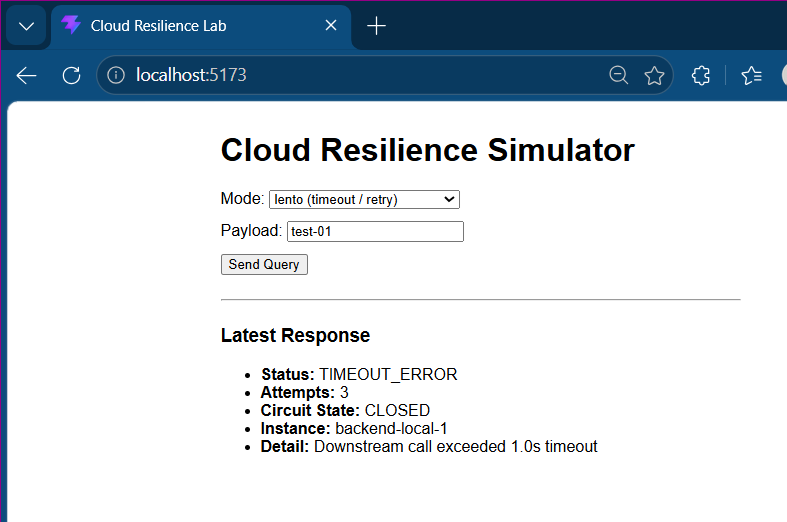
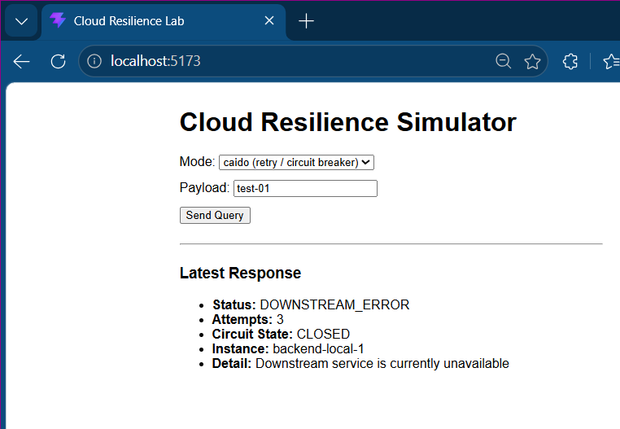
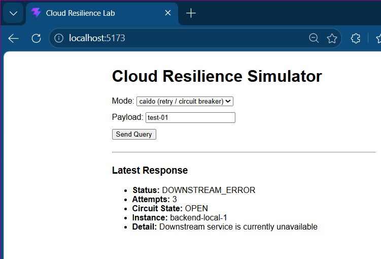
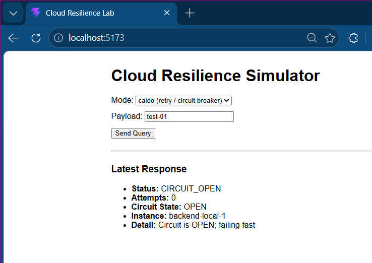
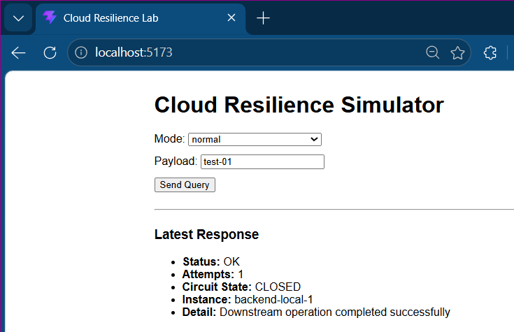

# Circuit Breaker and Timeout Patterns

## 1. Proposed solution

A small FastAPI backend simulates a call to a remote service (a "downstream" service) that can be
healthy, slow, or down. Three resilience patterns protect that call. This document covers the
**Timeout** and **Circuit Breaker** patterns; the **Retry** pattern is included because the other two
interact with it.

| Pattern | Problem it solves | Behavior in this project | Code |
|---|---|---|---|
| **Timeout** | A slow service can make the caller wait forever. | Every downstream call is cut after **1 second**. | [`downstream_client.py`](../app/backend/src/downstream_client.py) |
| **Retry** | Many failures are temporary. | Up to **2 retries** with exponential backoff (0.5 s, then 1 s). | [`retry_policy.py`](../app/backend/src/retry_policy.py) |
| **Circuit Breaker** | Calling a service that is clearly down wastes time and resources. | After **3 failed requests** the circuit opens and requests are rejected immediately for **10 seconds**. | [`circuit_breaker.py`](../app/backend/src/circuit_breaker.py) |

[`resilience_service.py`](../app/backend/src/resilience_service.py) coordinates the three patterns, and
[`api.py`](../app/backend/src/api.py) exposes them through `POST /api/v1/consultar`.

### Simulated modes

The request body is `{"modo": "<mode>", "payload": "..."}`:

| Mode | Simulated service behavior | Expected result |
|---|---|---|
| `normal` | Responds in about 50 ms. | `OK` |
| `lento` (slow) | Takes 2 s, longer than the 1 s timeout. | Every attempt times out, so `TIMEOUT_ERROR` |
| `caido` (down) | Raises an error. | Every attempt fails, so `DOWNSTREAM_ERROR` |

### Configuration

Set through environment variables (see [`config.py`](../app/backend/src/config.py) and
[`docker-compose.yml`](../app/docker-compose.yml)):

| Variable | Value | Meaning |
|---|---|---|
| `REQUEST_TIMEOUT_SEC` | `1.0` | Timeout of each downstream call |
| `SLOW_MODE_DELAY_SEC` | `2.0` | Delay simulated in `lento` mode |
| `MAX_RETRIES` | `2` | Retries after the first attempt (3 attempts in total) |
| `BASE_BACKOFF_SEC` | `0.5` | First wait between attempts, doubled each time |
| `FAILURE_THRESHOLD` | `3` | Failed requests before the circuit opens |
| `RECOVERY_TIMEOUT_SEC` | `10.0` | Seconds the circuit stays open before testing the service again |

## 2. Architecture diagrams

### 2.1 Circuit Breaker states



### 2.2 Request flow



### 2.3 Where it runs



## 3. Source code and configuration

| File | Role |
|---|---|
| `app/backend/src/circuit_breaker.py` | State machine: `CLOSED`, `OPEN`, `HALF_OPEN` |
| `app/backend/src/downstream_client.py` | Simulated downstream call with the timeout |
| `app/backend/src/retry_policy.py` | Retries with exponential backoff |
| `app/backend/src/resilience_service.py` | Combines the three patterns |
| `app/backend/src/api.py` | HTTP endpoints |
| `app/backend/Dockerfile`, `app/docker-compose.yml` | Container image and local run |
| `app/backend/tests/` | Automated tests (20) |
| `scripts/demo_circuit_breaker.py` | Live demo against the running backend |

## 4. How to reproduce

**Automated tests** (Python standard library only, no installation needed). Run from `app/backend`:

```bash
python -m unittest discover -s tests -v
```

**Live demo.** Start the backend and, in another terminal, run the script from the repo root.

```bash
# Option A: Docker
cd app && docker compose up --build -d backend
python ../scripts/demo_circuit_breaker.py http://localhost:8000

# Option B: without Docker (from app/backend, after pip install -r requirements.txt)
python -m uvicorn src.api:app --port 8000
python ../../scripts/demo_circuit_breaker.py http://localhost:8000
```

The demo takes about 45 seconds because it waits twice for the 10 s recovery period.

## 5. Test results (evidence)

All evidence is stored in [`docs/evidence/circuit-breaker-timeout/`](evidence/circuit-breaker-timeout/).

### 5.1 Automated tests: 20 of 20 passed

File: [`unit-tests-output.txt`](evidence/circuit-breaker-timeout/unit-tests-output.txt)

| Test file | Tests | What it checks |
|---|---|---|
| `test_circuit_breaker.py` | 9 | Every state transition, using a simulated clock |
| `test_timeout.py` | 4 | The call is cut at the timeout instead of waiting for the full delay |
| `test_resilience_service.py` | 7 | Timeout, retry and circuit breaker working together |

### 5.2 Live demo against the real backend

File: [`live-demo-output.txt`](evidence/circuit-breaker-timeout/live-demo-output.txt). The backend ran with
the same environment values as `docker-compose.yml`. Server log:
[`backend-server-log.txt`](evidence/circuit-breaker-timeout/backend-server-log.txt).

| Step | Mode | Result | Attempts | Circuit | Time | What it shows |
|---|---|---|---|---|---|---|
| 1 | normal | `OK` | 1 | CLOSED | 80 ms | Healthy path |
| 2 | lento | `TIMEOUT_ERROR` | 3 | CLOSED | 4558 ms | **Timeout** cuts each attempt at 1 s. **Retry** adds 2 more attempts plus 1.5 s of backoff |
| 3 | normal | `OK` | 1 | CLOSED | 58 ms | A success resets the failure counter |
| 4 | caido | `DOWNSTREAM_ERROR` | 3 | CLOSED | 1887 ms | Retries exhausted; breaker failure 1 of 3 |
| 5 | caido | `DOWNSTREAM_ERROR` | 3 | CLOSED | 1703 ms | Breaker failure 2 of 3 |
| 6 | caido | `DOWNSTREAM_ERROR` | 3 | **OPEN** | 1712 ms | Breaker failure 3 of 3, **the circuit opens** |
| 7 | caido | `CIRCUIT_OPEN` | **0** | OPEN | 6 ms | **Fail fast**: no downstream call is made |
| 8 | normal | `CIRCUIT_OPEN` | **0** | OPEN | 4 ms | While open, even a healthy request is rejected |
| 9 | caido | `DOWNSTREAM_ERROR` | 3 | OPEN | 1700 ms | After 10 s the trial request (`HALF_OPEN`) fails, so the circuit reopens |
| 10 | normal | `OK` | 1 | **CLOSED** | 81 ms | After 10 s the trial request succeeds, so the circuit closes |

The difference between steps 6 and 7 is the main result: a failing request costs about 1.7 s, while a
rejected request costs a few milliseconds.

### 5.3 Screenshots from the web interface

The full application ran with `docker compose up --build` (backend on port 8000, frontend on port 5173) and
was tested from http://localhost:5173.

**Containers running** in Docker Desktop:



**1. Mode `normal`**: `OK` on the first attempt, circuit `CLOSED`.



**2. Mode `lento` (slow)**: the 1 s timeout cuts every attempt. After 3 attempts the result is `TIMEOUT_ERROR`
(Timeout + Retry).



**3. Mode `caido` (down), first request**: 3 attempts fail, `DOWNSTREAM_ERROR`, the circuit is still `CLOSED`.



**4. Mode `caido`, third failed request**: the failure threshold is reached and the circuit becomes `OPEN`.



**5. Mode `caido`, fourth request**: the circuit is `OPEN`, so the request is rejected without calling the
service (`CIRCUIT_OPEN`, `Attempts: 0`).



**6. Recovery**: after the 10 s recovery period a healthy request succeeds and the circuit goes back to `CLOSED`.



## 6. Notes and limits

- The downstream service is **simulated** inside the backend. The patterns are real, but there is no remote service.
- The circuit breaker counts **failed requests**, not individual attempts. One request that fails after 3 attempts adds one failure.
- There is one breaker per backend process. If several backend instances run behind a load balancer, each keeps its own counter.
