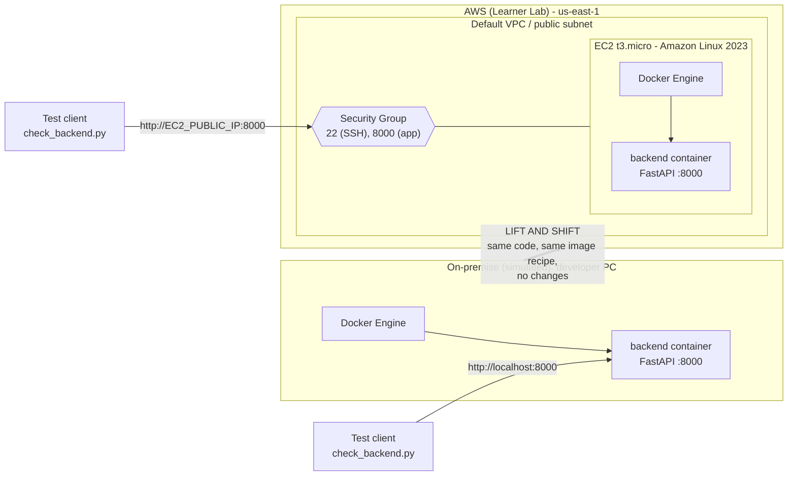
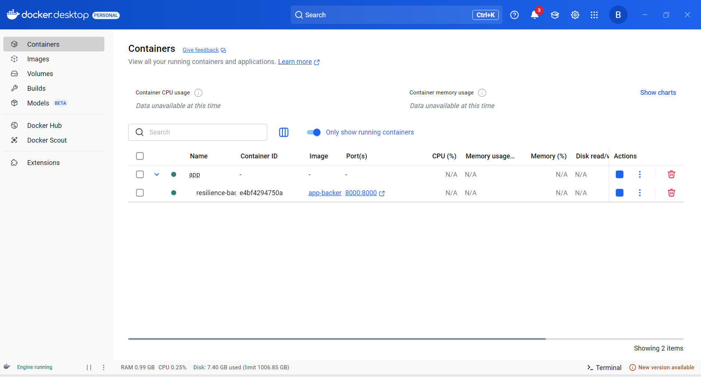

# Lift-and-Shift Migration Strategy (On-Premise to AWS)

## 1. Proposed solution

**Lift-and-Shift** (also called *rehosting*) moves an application to the cloud **without changing its code or
architecture**. The workload is "lifted" from the old environment and "shifted" onto cloud infrastructure
as it is. It is the fastest migration strategy, at the cost of not using cloud-native services yet.

In this exercise the application is the resilience backend of this repository (FastAPI, packaged with
Docker):

| Environment | What it is | How it runs |
|---|---|---|
| **On-premise (source)** | A local machine standing in for a company server. It is a *simulated* on-premise environment. | `docker compose up backend` on the developer PC |
| **AWS (target)** | An **EC2** instance (Amazon Linux 2023) in the default VPC. | The **same** `docker-compose.yml`, run on the instance |

The migration is considered successful when the backend answers **identically** in both environments
without a single change to the code, the Dockerfile or the compose file.

## 2. Architecture diagram



## 3. Migration stages applied

| Stage | What was done in this exercise |
|---|---|
| **1. Assessment** | The backend is stateless, listens on port 8000 and is already containerized, so it needs no code changes. The frontend is left out: it calls `localhost:8000`, which only makes sense on the same machine. |
| **2. Preparation** | The target is sized and secured: a `t3.micro` EC2 instance and a Security Group that opens port 22 (administration) and port 8000 (application). |
| **3. Migration** | [`scripts/ec2-bootstrap.sh`](../scripts/ec2-bootstrap.sh) installs Docker, clones the repository and starts the same compose service on the instance. |
| **4. Validation** | [`scripts/check_backend.py`](../scripts/check_backend.py) runs the same checks against both environments and the results are compared. |
| **5. Cutover** | Clients switch their base URL from `http://localhost:8000` to `http://<EC2_PUBLIC_IP>:8000`. |

## 4. Source code and configuration

| File | Role |
|---|---|
| `app/backend/Dockerfile` | Image recipe. Unchanged by the migration. |
| `app/docker-compose.yml` | Service definition. Unchanged by the migration. |
| `scripts/ec2-bootstrap.sh` | Prepares the EC2 instance and starts the app. |
| `scripts/check_backend.py` | Smoke test used on both environments. |

## 5. Procedure

### 5.1 On-premise baseline (local PC)

```bash
cd app
docker compose up --build -d backend
python ../scripts/check_backend.py http://localhost:8000
docker compose down
```

### 5.2 AWS (Learner Lab)

1. **Start the lab** from AWS Academy (**Start Lab**) and open the AWS console in region `us-east-1`.
2. **Security Group.** EC2 > Security Groups > Create security group. Name: `lift-shift-sg`. Inbound rules:
   SSH (22) from *My IP*, and Custom TCP (8000) from `0.0.0.0/0`.
3. **Launch the instance.** EC2 > Launch instance. Name: `lift-and-shift-backend`. AMI: Amazon Linux 2023.
   Type: `t3.micro`. Key pair: `vockey`. Network: default VPC, public subnet, *Auto-assign public IP* enabled.
   Security group: `lift-shift-sg`.
4. **Connect** with EC2 Instance Connect (browser terminal) and deploy:

   ```bash
   curl -fsSL https://raw.githubusercontent.com/ldalomoto/cloud-resilience-lab/feat/lift-and-shift/scripts/ec2-bootstrap.sh -o ec2-bootstrap.sh
   bash ec2-bootstrap.sh feat/lift-and-shift backend
   ```

5. **Validate from the local PC** against the public IP of the instance:

   ```bash
   python scripts/check_backend.py http://<EC2_PUBLIC_IP>:8000
   ```

6. **Stop the instance** when finished (EC2 > Instance state > Stop) to avoid using lab credit.
   The public IP changes every time the instance is stopped and started again.

## 6. Test results (evidence)

Evidence is stored in `docs/evidence/lift-and-shift/`.

- [x] [`01-onpremise-check.txt`](evidence/lift-and-shift/01-onpremise-check.txt): `check_backend.py` against `http://localhost:8000`
- [x] `01b-onpremise-container.png`: Docker Desktop showing the backend container running on port 8000


- [ ] `02-ec2-security-group.png`: Security Group inbound rules
- [ ] `03-ec2-instance-running.png`: EC2 instance running, with its public IP
- [ ] `04-ec2-bootstrap-output.png`: end of `ec2-bootstrap.sh` showing the container `Up`
- [ ] `05-aws-check.txt` or screenshot: `check_backend.py` against `http://<EC2_PUBLIC_IP>:8000`

### Comparison to fill in

| Check | On-premise (`localhost:8000`) | AWS (`EC2_PUBLIC_IP:8000`) |
|---|---|---|
| `GET /health` | | |
| `POST /api/v1/consultar` (normal) | | |
| Code changes needed | 0 | 0 |

## 7. Trade-offs and limits

- **Advantage:** very fast and low risk, because nothing is rewritten.
- **Limit:** the application keeps its original architecture. It runs on a single instance with no
  auto scaling, no managed load balancer and no managed services.
- **Next step (modernization):** move the container to a managed service such as ECS or Fargate, and put an
  Application Load Balancer in front of it.
- The on-premise environment is **simulated** with a local machine, because no physical data center is available.
